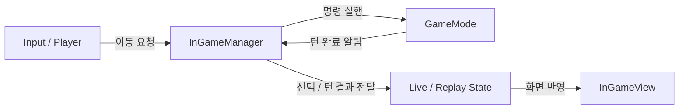

<h3 align="center">Tech Stack</h3>

  
  

  Unity 6000.3.26f1 / C# / URP / UniTask / DOTween 
  Input System / uGUI / TextMeshPro / AudioMixer / Object Pool 
  TCP / Length-Prefixed JSON / UPM / npm / JSON 설정 저장

# YuJanggi.Unity

Windows / Android에서 로컬 / AI / 온라인 대국을 지원하는 Unity 장기 클라이언트입니다.
공용 Engine으로 장기 규칙과 기보를 처리하며, 온라인 대국은 .NET 서버가 확정한 이벤트를 기준으로 진행합니다.

## Highlights

- **세 가지 대국 모드**: 한 기기에서 두 진영을 조작하는 Local / AI 상대 대국 / TCP 서버를 통한 Network 대국
- **대국과 기보 탐색 분리**: 과거 수순을 보는 동안 실제 대국과 라이브 UI 갱신을 유지
- **서버 확정 기반 동기화**: 턴 번호와 Engine 적용 결과를 대조하고, 중복 이벤트와 상태 불일치를 구분해 처리
- **모바일 화면 대응**: 마우스 / 터치 입력, Safe Area UI 배치와 화면비에 따른 카메라 시야 보정
- **공용 패키지 사용**: 서버와 공유하는 Engine / Protocol을 npm Scoped Registry에서 UPM으로 설치

## 플레이 빌드

공개된 **play-v1.1.0** 빌드입니다.

- **[Windows ZIP 다운로드](https://github.com/SeokJinYoo98/YuJanggi.Unity/releases/download/play-v1.1.0/YuJanggi.v1.1.0.zip)**: 압축을 모두 해제한 뒤 `YuJanggi.exe`를 실행합니다.
- **[Android APK 다운로드](https://github.com/SeokJinYoo98/YuJanggi.Unity/releases/download/play-v1.1.0/YuJanggi_v1.1.0.apk)**: Android 기기에 APK를 설치합니다.

[플레이 빌드 Release](https://github.com/SeokJinYoo98/YuJanggi.Unity/releases/tag/play-v1.1.0)

배포 빌드와 현재 main 소스는 버전이 다를 수 있습니다.
온라인 접속에는 클라이언트와 서버의 Engine / Protocol 버전 일치가 필요합니다.

## 프로젝트 실행

1. **Unity 6000.3.26f1**과 사용할 플랫폼의 Build Support를 준비합니다.
2. [manifest.json](Packages/manifest.json)에 설정된 의존성을 복원합니다.
3. [BootStrapScene](Assets/Scenes/BootStrapScene.unity)을 열고 Play합니다. 초기화 후 `LobbyScene`으로 이동합니다.

현재 패키지 버전은 **Engine 2.8.4 / Protocol 1.8.0**입니다.
`https://registry.npmjs.org`와 `com.yujanggi` Scope가 프로젝트에 설정되어 있습니다.

Local / AI는 서버 없이 사용할 수 있습니다.
Network는 서버와 두 클라이언트가 필요하며, 연결 후 버전 Handshake를 진행합니다.

### 서버 접속 설정

[YuJanggiBootStrap.GetServerEndpoint](Assets/Scripts/Bootstrap/YuJanggiBootStrap.cs)에서 접속 주소를 결정합니다.

- **`SERVER_HOST`**: 접속할 서버 주소. 설정하지 않으면 코드에 정의된 기본 서버 주소를 사용합니다.
- **`SERVER_PORT`**: 유효한 포트 번호를 설정하며, 기본값은 `7777`입니다.
- **로컬 서버 연동**: `SERVER_HOST=127.0.0.1`을 설정한 환경에서 Unity Editor를 시작합니다. Android 등 다른 기기에서는 서버 PC의 접근 가능한 IP를 사용해야 합니다.

### 플랫폼 빌드

[Build Profiles](Assets/Settings/Build%20Profiles)에 Windows용 `Debug` / `Release`와 `Android™` 프로필이 있습니다.
기본 씬 순서는 `BootStrapScene → LobbyScene → JanggiScene`입니다.

## 대국 기능

- **Local / AI**: 클라이언트 Engine이 이동과 턴을 처리합니다. AI는 Random / Greedy / Minimax 전략을 선택합니다.
- **온라인 대국**: 매칭과 포진 선택 후 양측 게임 씬 준비를 기다립니다. 이동 / 한 수 쉼 / 기권을 요청하고, 대국 종료 후 양측 동의로 리매치합니다.
- **보드 조작**: 기물을 선택하면 이동 가능 위치를 표시합니다. Local / AI에서는 무르기를 지원합니다.
- **기보 탐색**: 이전 / 다음 수순을 탐색하고 선택한 이동을 반복 표시합니다. 최신 기록에서 Live로 복귀합니다.
- **채팅 / 음량 설정**: 서버 채팅 이벤트를 말풍선으로 표시합니다. Master / SFX / UI / BGM 음량은 `Application.persistentDataPath/PlayerSettings.json`에 저장하고 다음 실행에서 복원합니다.

## Architecture

게임 진행 방식은 GameMode, 보드 표시와 기보 탐색은 Live / Replay State로 구분합니다.

- **[InGameManager](Assets/Scripts/InGame/InGameManager.cs)**: Engine / Mode / State 생성과 연결, 생명주기와 상태 전환, 버튼 입력과 이벤트 전달
- **[GameMode](Assets/Scripts/InGame/GameMode/GameMode.cs)**: Local / AI / Network별 명령 실행, 턴 준비와 입력 활성화
- **[Live State](Assets/Scripts/InGame/State/InGameLiveState.cs) / [Replay State](Assets/Scripts/InGame/State/InGameReplayState.cs)**: 최신 보드 표시 / 과거 수순 표시와 탐색. Replay 진입 시 로컬 보드 입력을 중지하고 Live 복귀 시 다시 연결
- **[InGameView](Assets/Scripts/InGame/Views/InGameView.cs)**: 보드 / 기물 / 대국 UI / 효과와 사운드 표현
- **[NetworkManager](Assets/Scripts/Network/NetworkManager.cs)**: TCP 연결과 수신 루프, 응답과 기능별 이벤트 분배

Replay는 화면 탐색 상태이므로 게임 진행을 멈추지 않습니다.
실제 Engine과 기록은 계속 갱신하며, Live로 돌아올 때 최신 보드와 UI를 동기화합니다.

## 온라인 동기화

[RequestDispatcher](Assets/Scripts/Network/RequestDispatcher.cs)는 RequestId와 예상 응답 타입으로 요청과 응답을 연결합니다.
요청 / 응답 대기에는 제한시간과 연결 / 게임 생명주기의 CancellationToken을 적용합니다.

[NetworkMode](Assets/Scripts/InGame/GameMode/NetworkMode.cs)는 승인 응답만으로 보드를 변경하지 않습니다.

1. 서버가 전달한 현재 턴 번호를 이동 / 한 수 쉼 요청에 담습니다.
2. `TurnCompletedEvent`를 받으면 서버의 턴 번호 / 행동 진영 / 다음 차례를 로컬 Engine 상태와 대조합니다.
3. 확정된 이동 또는 한 수 쉼을 Engine에 적용하고 기록 수와 결과를 확인한 뒤 화면에 반영합니다.
4. `GameEndedEvent`의 승자 / 종료 사유 / 총 수순으로 대국 결과를 확정합니다.

중복 / 과거 턴 이벤트는 무시합니다.
턴 번호 누락이나 Engine 적용 불일치, 명령 결과 대기 실패로 상태를 확인할 수 없으면 로컬 입력을 차단합니다.

Network 모드에서는 클라이언트 Engine의 시간 진행을 끕니다.
남은 시간은 서버가 전달한 마감 시각으로 표시하고, 시간 초과에 따른 한 수 쉼도 서버 이벤트로 반영합니다.
이 시간 표시는 클라이언트 시계의 영향을 받으며, 대국 시간 판정은 서버가 담당합니다.

## 모바일 화면 대응

[SafeArea](Assets/Scripts/UI/SafeArea.cs)는 `Screen.safeArea`를 기준으로 조작 UI의 앵커를 조정합니다.
화면 크기나 안전 영역이 바뀌면 다시 적용합니다.

[PortraitCamera](Assets/Scripts/InGame/Views/PortraitCamera.cs)는 9:16 기준의 가로 표시 범위를 유지하도록 카메라 시야를 보정합니다.
보드 입력은 Input System의 마우스 / 기본 터치 바인딩을 공유합니다.

## 현재 범위 / 남은 작업

로컬 / AI / 온라인 대국, 기보 탐색, 리매치, 채팅, 음량 저장과 모바일 화면 대응을 구현했습니다.
사용자 인증 / DB 연동, 상대 이탈 알림 / 재접속 복구와 상태 불일치 이후의 전체 재동기화는 남은 작업입니다.
연결 종료 안내와 화면 복귀 정책도 보완할 영역입니다.

Unity 저장소에는 별도 CI/CD Workflow가 없습니다.
공용 패키지의 빌드 / 테스트 / NuGet 및 UPM 배포는 Engine / Protocol 저장소에서 관리합니다.

## 관련 프로젝트

- [YuJanggi.Engine](https://github.com/SeokJinYoo98/YuJanggi.Engine) — 장기 규칙 / 대국 상태 / 턴 처리 / 기보
- [YuJanggi.Protocol](https://github.com/SeokJinYoo98/YuJanggi.Protocol) — 공용 메시지 계약 / 직렬화 / 패킷 프레이밍
- [YuJanggi.Server](https://github.com/SeokJinYoo98/YuJanggi.Server) — 서버 권위 대국 / 매칭 / GameRoom / 리매치 / 채팅 / EC2 배포
